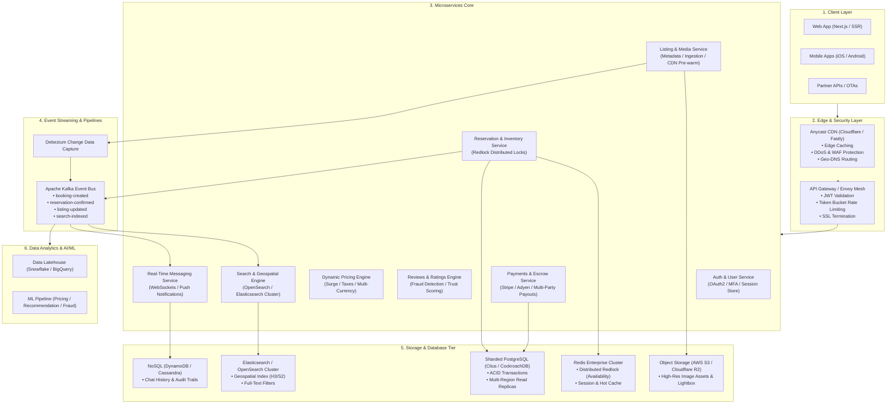

# Production-Scale Vacation Rental Marketplace Architecture
## Distributed Systems Design & Scaling Strategy (Airbnb-Scale)

This document details the high-level and subsystem architecture for a global, multi-region vacation-rental marketplace designed to serve **50M+ Monthly Active Users (MAU)**, **10M+ active property listings**, and **50,000+ bookings per minute** during peak flash campaigns.

---

## 1. System Architecture Overview



---

## 2. Key Subsystems & Technical Deep Dive

### 2.1. Prevention of Double-Booking (High Contention Concurrency)
- **Problem**: In popular destinations (e.g., Oia, Santorini during sunset season), multiple users may click "Reserve" for the exact same dates simultaneously.
- **Solution**:
  1. **Distributed Redlock on Redis Cluster**: Key pattern `lock:listing:{listingId}:{date}` with a 10-second TTL acquired atomically during reservation checkout initiation.
  2. **PostgreSQL Exclusion Constraints & Versioning**:
     ```sql
     ALTER TABLE reservations
     ADD CONSTRAINT no_overlapping_dates
     EXCLUDE USING gist (
       listing_id WITH =,
       daterange(check_in, check_out, '[)') WITH &&
     ) WHERE (status IN ('confirmed', 'pending_payment'));
     ```
  3. **Two-Phase Reservation State Machine**:
     `INITIATED` -> `LOCKED` -> `PAYMENT_PENDING` -> `CONFIRMED` / `EXPIRED`.

---

### 2.2. Sub-50ms Search & Geospatial Discovery
- **OpenSearch / Elasticsearch Geo-Clustering**:
  - Properties indexed using Uber H3 discrete global grid indices (resolution level 8 for neighborhood clustering).
  - Spatial bounding box queries (`geo_bounding_box`) combined with date availability bitsets.
  - Multi-level caching: Edge CDN cached search results for popular destinations with 60-second TTL.

---

### 2.3. Dynamic Pricing & Currency Conversion
- **Calculations**:
  - `BaseNightlyRate * NumberOfNights`
  - Long-stay weekly/monthly discount triggers (`-10%` for >= 7 nights)
  - Host Cleaning fee + Platform Service fee (`14%`) + Municipal Hospitality Taxes (`12%`)
- **Real-Time FX Rate Engine**:
  - Redis cache stores mid-market rates from Bloomberg/OpenExchange updated every 5 minutes, allowing zero-latency currency toggling across USD, EUR, GBP, JPY, and INR.

---

### 2.4. Global CDN & Media Pipeline
- **Asset Processing**:
  - Images uploaded directly to AWS S3 using presigned URLs.
  - AWS Lambda / Cloudflare Workers transform raw photos into responsive AVIF / WebP variants (500px, 1200px, 1600px).
  - Globally replicated CDN edge nodes guarantee <20ms Time-to-First-Byte (TTFB) worldwide.

---

### 2.5. Fault Tolerance & Multi-Region Disaster Recovery
- **Active-Active Multi-Region Deployment**:
  - Primary regions in US-East, EU-Central, and AP-Southeast.
  - CockroachDB / Citus multi-region geo-partitioned tables store European guest data inside EU for strict GDPR compliance.
  - Circuit Breakers (Resilience4j / Envoy) isolate downstream payment failures and fallback gracefully.

---

### 2.6. Observability & SRE Metrics
- **OpenTelemetry & Prometheus**: Distributed trace propagation with OpenTelemetry W3C trace contexts.
- **Service Level Objectives (SLOs)**:
  - 99.99% Availability for Booking and Checkout flows (< 4.38 mins downtime/year).
  - p95 Search Latency < 65ms.
  - p99 Reservation Transaction Latency < 180ms.
